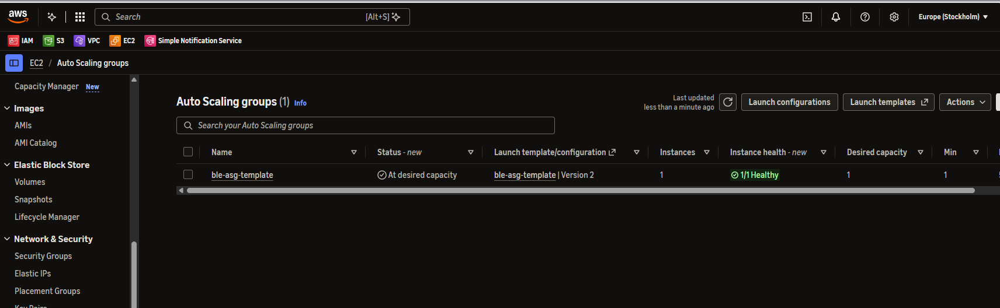
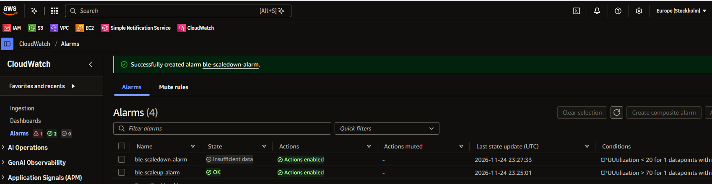

# AWS EC2 Auto Scaling, CloudWatch & SNS Lab 

## Overview
Built, tested and decommissioned an automated EC2 Auto Scaling infrastructure integrated with CloudWatch alarms, scaling policies, and SNS email notifications in AWS.

## What I Built
- **Networking & Security:** Custom VPC, subnets, route tables, and security groups configured for controlled inbound access.
- **Compute & Launch Configuration:** EC2 Launch Template (`ble-asg-template`) configured with User Data and a least-privilege IAM role/instance profile (`CloudWatchAgentServerPolicy`).
- **Auto Scaling Group:** Deployed an ASG (`min: 1`, `desired: 3`, `max: 5`) to automatically adjust compute capacity based on demand.
- **Observability & Alerting:** Created CloudWatch CPU utilization alarms (`ble-scaleup-alarm` > 70% and `ble-scaledown-alarm` < 20%), dynamic scaling policies, and an SNS topic for real-time email alerts.
- **Cost-Safe Teardown:** Deleted the ASG, CloudWatch alarms, Launch Template, SNS topic, and custom VPC immediately after validation to prevent ongoing charges.

## Real-World Challenges & Debugging
- **Scaling Policy Configuration:** Encountered a policy conflict when attempting to create multiple Target Tracking policies on the same Average CPU metric; resolved by switching to explicit step scaling policies tied to separate scale-up and scale-down CloudWatch alarms.
- **Public vs. Private IP Networking:** Diagnosed an SSH `Connection timed out` on port 22 caused by attempting to connect to a private IP (`10.x.x.x`) on an instance without an auto-assigned public IPv4 address, reinforcing subnet IP settings and EC2 Instance Connect usage.
- **IAM & Console Troubleshooting:** Resolved IAM role attachment/creation issues so EC2 instances launched with the required permissions for CloudWatch monitoring.

## Proof of Work
### Auto Scaling Group Status

### CloudWatch Scale-Up & Scale-Down Alarms

